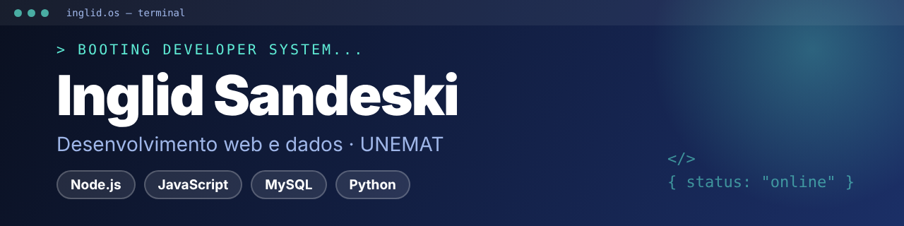

<div align="center">



<a href="https://github.com/inglid-sandeski">
  
</a>

</div>

<br>

## `01 // IDENTITY`

```typescript
const developer = {
  name: "Inglid Sandeski",
  role: "Estudante de Sistemas de Informação (6º semestre, UNEMAT)",
  location: "Sinop, MT — Brasil",
  stack: ["Node.js", "Express", "JavaScript", "MySQL", "Python"],
  studying: "Back-end com Node.js, bancos de dados e análise de dados",
  building: "Projetos com README e passo a passo para rodar",
  lookingFor: "Primeira oportunidade como desenvolvedora (estágio ou júnior)",
  mindset: "Aprender na prática. Documentar. Evoluir.",
};
```

<br>

## `02 // TECH_STACK`

**Front-end**


**Back-end**


**Banco de dados**


**Dados e visualização**


**Ferramentas**


<br>

## `03 // TERMINAL`

```bash
> booting inglid.os ...

[ OK ] Perfil carregado
[ OK ] Módulos de front-end carregados
[ OK ] Módulos de back-end carregados
[ OK ] Módulos de dados carregados

ROLE      : Estudante de Sistemas de Informação (UNEMAT)
STACK     : Node.js · Express · MySQL · Python
BUILDING  : APIs REST, sistemas web e dashboards
STUDYING  : Back-end, bancos de dados e análise de dados
STATUS    : ONLINE

> aguardando o próximo desafio... █
```

<br>

## `04 // FEATURED_PROJECT`

<table>
  <tr>
    <td>
      <h3>📚 CRUD de Livros</h3>
      <p>Aplicação completa para cadastrar, listar, editar e excluir livros: API REST em Node.js e Express, banco MySQL e interface em HTML, CSS e JavaScript. Tem validação dos dados no servidor, tratamento de erros (como ISBN duplicado) e configuração por variáveis de ambiente.</p>
      <p><code>Node.js</code> <code>Express</code> <code>MySQL</code> <code>JavaScript</code></p>
      <p><b>Status:</b> funcional, com README e pronto para deploy</p>
      <a href="https://github.com/inglid-sandeski/DW.CRUD_Livros"></a>
    </td>
  </tr>
</table>

<br>

## `05 // PROJECT_ARCHIVE`

| Projeto | O que faz | Tecnologias |
| --- | --- | --- |
| [📊 Dashboard de Vendas](https://github.com/inglid-sandeski/inglid-sandeski.ied-streamlit) | Dashboard interativo com 8 filtros, 6 indicadores, 14 gráficos e 2 mapas, a partir de um CSV de vendas | `Python` `Streamlit` `Plotly` `pandas` |
| [📦 Gerenciamento de Estoque](https://github.com/inglid-sandeski/Gerenciamento-de-Estoque) | Cadastro, edição, exclusão e impressão do estoque, com dados no Firebase | `JavaScript` `Firebase` `HTML` `CSS` |
| [🔎 Buscador de Pokémon](https://github.com/inglid-sandeski/Buscador-de-Pok-mon) | Busca por nome ou habilidade na PokéAPI, com tipos, medidas e fraquezas | `JavaScript` `API REST` `HTML` `CSS` |

<br>

## `06 // SYSTEM_METRICS`

<div align="center">


</div>

> Os cartões de métricas dependem de serviços externos gratuitos e podem ficar temporariamente fora do ar. Os números são calculados pelo próprio GitHub a partir da minha atividade.

<br>

## `07 // CONTRIBUTION_MATRIX`

<div align="center">


</div>

<br>

## `08 // CONNECT`

<div align="center">

[](https://www.linkedin.com/in/inglid-sandeski-1077861ba/)
[](https://www.instagram.com/pablynne.sandeski/)
[](https://github.com/inglid-sandeski)
[](mailto:bynnesandeski@gmail.com)

<sub>`> awaiting next challenge... █`</sub>

</div>
